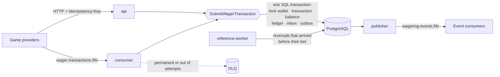

<div align="center">

# wagering-processor

**A distributed wallet service for betting operations that stays correct when messages are duplicated, arrive out of order, run at the same time on several instances, or a process dies halfway.**

[](https://github.com/JonasBorgesLM/wagering-processor/actions/workflows/ci.yml)


Built for the [Jungle Gaming backend challenge](https://github.com/junglegaming/backend-challenge) · v1.1.1

</div>

---

Game providers send `BET`, `WIN`, `LOSS`, `REFUND` and `ROLLBACK` operations over HTTP or through an SQS queue. Each one is applied to a player's wallet **exactly once**, however many times it is sent, in whatever order, through whichever instance. Every balance change has its ledger entry, and the stored balance always equals what the ledger rebuilds.

> **Status: v1.1.1.** Everything the challenge asks for is implemented and tested against real PostgreSQL and a real SQS emulator, including a failure suite that kills real processes. What is **not** here is listed under [Known limitations](#known-limitations). Read it before relying on this.

## Contents

[Guarantees](#guarantees) · [How it works](#how-it-works) · [Business rules we follow](#business-rules-we-follow) · [Decisions we made](#decisions-we-made) · [Quick start](#quick-start) · [API](#api) · [How it is verified](#how-it-is-verified) · [Known limitations](#known-limitations) · [Documents](#documents)

## Guarantees

| What cannot happen | Why it cannot |
| --- | --- |
| **A debit or credit applied twice** | The idempotency key and the provider's own id are both `UNIQUE` in the database, with a hash of the payload; a queue message is also recorded in a persistent inbox in the same transaction. Memory plays no part. |
| **A negative balance, or a lost update** | Every settlement runs under `SELECT … FOR UPDATE` on the wallet row, and `balance >= 0` is a `CHECK` in the schema. A bug in the code is refused by the database. |
| **A balance the ledger does not explain** | The balance, the ledger entry, the transaction, the inbox row and the events commit in one SQL transaction. The ledger's arithmetic is a `CHECK`, and triggers refuse any `UPDATE`, `DELETE` or `TRUNCATE` on it. |
| **An event published before its commit, or lost after it** | Events are written to an outbox in the same transaction and published afterwards by a worker with a lease. A publisher that dies hands its rows on; a repeat carries the same `eventId`. |
| **Money as a float** | `Money` holds a `bigint` of minor units, parses only `"25.00"`-shaped strings, has no rounding path, and is `numeric(20,2)` in the database. A CI guard fails the build on float arithmetic for money. |
| **Correct only with one instance** | No lock or state lives in a process. The failure suite runs three or more real processes and kills them mid-work. |

## How it works



One deployable, four roles chosen per process by `APP_ROLES` (`api`, `consumer`, `publisher`, `reference-worker`). HTTP and the queue call **the same use case**. Responding, acknowledging and publishing all happen **after** the commit and are safe to repeat, so a crash at any point either left nothing behind or left something that is finished the next time.

## Business rules we follow

The rules of the challenge, and where each is enforced. "Schema" means a database constraint or trigger, which holds even if the code is wrong.

| Rule (challenge section) | Where it is enforced |
| --- | --- |
| Amounts are decimal strings with exactly two places; `NaN`, `Infinity`, scientific notation, empty, negative and three-decimal inputs are refused (§6.1) | `Money`, the request parser, `numeric(20,2)` |
| One wallet per player and currency (§6.2) | Schema (`UNIQUE`), answered `409` |
| The balance is never negative (§6.2) | Wallet lock, `Wallet`, schema (`CHECK`) |
| Every balance change has one ledger entry, and the ledger is never changed (§5, §6.4) | One transaction per operation, schema (`UNIQUE (transaction_id)`, arithmetic `CHECK`, append-only trigger), reconciliation |
| `version` starts at 1 and rises only when the balance changes (§6.2) | `Wallet`, schema (`UNIQUE (wallet_id, wallet_version)` on the ledger) |
| A positive opening balance creates an internal `OPENING` with its credit, in the same transaction; `OPENING` cannot be submitted (§6.3, §9) | `OpenWallet`, the reserved provider `internal`, schema (`CHECK`) |
| `BET` debits, `WIN` credits, `LOSS` moves nothing, `REFUND` credits, `ROLLBACK` inverts its reference (§7) | `decideSettlement` and `ledgerDirectionFor` |
| `REFUND` and `ROLLBACK` need a reference, resolved by provider and external id, in the same provider, player, wallet, currency and round; `REFUND` reverses a `BET`, `ROLLBACK` a `BET`, `WIN` or `REFUND`; the amount must be equal (§7.1–7.5) | `decideSettlement`, schema (reference required by kind, same-wallet foreign key) |
| A reversal that would make the balance negative is refused with its own code, `REVERSAL_INSUFFICIENT_FUNDS` (§7.9) | `decideSettlement` |
| A rejected operation changes nothing and writes no ledger entry, and stays auditable (§7.6) | The rejection is stored as a transaction with its `failureCode` |
| Repeating an operation returns the original result, including the balance observed then (§7.7) | The stored transaction is the answer, `idempotentReplay: true` |
| The same key with a different payload is a conflict, not a replay (§6.3, §9) | Payload hash compared with the stored one, answered `409` |
| A missing reference waits and is retried with backoff; when the limit runs out it is rejected with its own code and an event (§7.1) | `PENDING_REFERENCE`, the reference worker, `REFERENCE_NOT_FOUND` |
| Every rejection carries a stable, machine-readable code (§7.2) | The codes, each with what a provider should do, in REQUIREMENTS section 3.8 |
| The wallet is the unit of concurrency; no global lock; correct with three or more instances (§5, §8) | Row lock per wallet, proven with real processes |
| Broker ordering and deduplication are an optimization, never the guarantee (§5, §8) | The database decides; FIFO groups only keep a wallet's order |
| Inbox, financial change, ledger and outbox in one transaction; acknowledge only after commit; business errors acknowledged, transient retried, permanent to the DLQ, with an attempt limit (§6.5, §10, §11) | Consumer, inbox step, outbox, `classifyFailure`, `maxReceiveCount` |
| On `SIGTERM`, finish what is in flight or give it back (§10) | Drain: readiness fails, the message in hand finishes, the rest is returned to the queue |
| Reconciliation flags, logs and counts a divergence and never corrects it (§9) | `POST /wallets/:walletId/reconciliation` |

## Decisions we made

Where the challenge leaves room, or where reading it strictly matters, the choice is recorded with its reason and the option not taken. **These are the decisions to know first.**

| Decision | Why | Record |
| --- | --- | --- |
| **A bet can be reversed once, by `REFUND` or by `ROLLBACK`, never both.** | The challenge forbids repeating a reversal of the same kind; allowing a refund and a rollback of the same bet would credit the stake twice. Confirmed with the project owner. | [ADR-0006](docs/adr/0006-one-processed-reversal-per-reference.md), INT-06 |
| **Pessimistic lock on the wallet row, taken before any insert.** | Settlement reads the reference, checks reversals and decides; that does not fit one conditional `UPDATE`, and optimistic retries burn work exactly on the hot wallet the challenge scores. Inserting first deadlocks, and a test reproduces it. | [ADR-0003](docs/adr/0003-wallet-row-lock-is-taken-before-any-insert.md) |
| **Idempotency is two unique keys in the database plus a payload hash.** | The key alone would let the same provider operation in under another key; the provider's id alone would not catch a changed payload. The hash is SHA-256 of a canonical JSON of the business fields, so a replay matches across HTTP and SQS. | [ADR-0005](docs/adr/0005-idempotency-is-enforced-by-two-unique-keys.md), FR-51 |
| **`Money` is a `bigint` of minor units.** | Exact, fast and impossible to round by accident. | [ADR-0004](docs/adr/0004-money-is-bigint-minor-units.md) |
| **HTTP settles synchronously: `200` applied, `202` waiting for its reference, `422` refused by a rule.** | The challenge's sample answers `PROCESSED`, and a provider should know the outcome without polling. | [ADR-0010](docs/adr/0010-http-settles-synchronously.md) |
| **One error envelope and one mapping, so the status alone says whether to resend.** | `400` fix it, `409` conflict, `422` a rule refused it, `503` nothing changed and resend, `500` a bug. | [ADR-0012](docs/adr/0012-errors-are-one-envelope-with-one-mapping.md) |
| **A reversal waits up to one hour for its reference**, retried with backoff from 5 s to 5 min. | Long enough for ordinary redelivery and provider retries, short enough not to leave a reversal open for a whole session. A duration is easier to reason about than an attempt count. | INT-13 |
| **A queue message that cannot succeed goes to the DLQ** (a conflict, an unknown wallet, an invalid payload). | A queue has no caller to answer, and retrying cannot change the verdict. | INT-17 |
| **`FAILED` has its own code, `SETTLEMENT_FAILED`,** and is set at the first error that retrying cannot fix. | A business code would blame the provider's payload for our fault. | INT-20, FR-32 |
| **`WIN` on a bet that was already reversed is refused.** | It protects against paying a voided bet. | INT-09 |
| **`LOSS` may reference a `BET`, and is the only operation that may be `0.00`.** | It records an outcome and moves nothing; every ledger amount is positive. | INT-04, INT-05 |
| **Several `BET` and `WIN` per round, and no round state machine.** | The challenge defines none, and multi-payout games exist. | INT-07, INT-08 |
| **Creating a wallet twice is a `409`, even with an identical request.** | The challenge asks for a conflict; a key on wallet creation would turn it into a replay. | INT-26 |
| **The opening of a wallet publishes events like any other applied transaction.** | "Any applied transaction" includes it. | INT-18 |
| **Events go to their own queue, `wagering-events.fifo`.** | Publishing into the input queue would feed consumers their own events. | INT-19 |
| **The inbox and the outbox are rows written by statements, not domain classes.** | Every guarantee they carry is a property of the statement that writes or claims them. | [ADR-0013](docs/adr/0013-inbox-and-outbox-are-rows-not-domain-classes.md) |
| **Authentication is not implemented; a no-op guard on every business route is the extension point.** | The challenge awards it no points and accepts a documented design. | [ADR-0009](docs/adr/0009-authentication-is-a-documented-extension-point.md) |
| **One deployable, roles chosen per process.** | Three instances of everything, or one process per role, from the same image. | [ADR-0001](docs/adr/0001-one-deployable-with-role-selected-processes.md) |
| **MiniStack as the local SQS.** | LocalStack now requires a licence token. Contract tests pin the broker behaviour relied on. | [ADR-0008](docs/adr/0008-ministack-is-the-local-sqs.md) |

All 26 interpretations are in [REQUIREMENTS section 7](REQUIREMENTS.md#7-interpretations), and every ADR in [`docs/adr/`](docs/adr/README.md).

## Quick start

Requirements: [Bun](https://bun.sh) 1.4 or later, Docker with Compose.

```bash
bun install
cp .env.example .env
docker compose up -d --wait postgres sqs
bun run provision        # create the queues
bun run migrate up
bun run start
curl localhost:3000/health/ready
```

Three instances in containers:

```bash
docker compose --profile app up -d --build
curl localhost:3001/health/ready   # also 3002, 3003
```

## Configuration

All through environment variables; `.env.example` has the defaults and a bad value stops the process at start. `APP_ROLES` chooses what one process does (ADR-0001): `api`, `consumer`, `publisher`, `reference-worker`, comma separated, all four by default.

| Variable | Default | What it bounds |
| --- | --- | --- |
| `PORT`, `DATABASE_URL`, `AWS_REGION`, `SQS_ENDPOINT` | see `.env.example` | where it listens and what it talks to |
| `SHUTDOWN_TIMEOUT_MS` | 25000 | how long a stopping process may take before it exits 1 |
| `LOCK_TIMEOUT_MS`, `STATEMENT_TIMEOUT_MS` | 2000, 5000 | the wait for a wallet lock; the longest any statement may run |
| `DATABASE_POOL_MAX`, `DATABASE_ACQUIRE_TIMEOUT_MS` | 10, 1000 | connections per process; the wait to get or open one |
| `INBOX_RETENTION_DAYS`, `OUTBOX_RETENTION_DAYS`, `RETENTION_INTERVAL_MS` | 21, 30, 3600000 | age past which inbox rows and published outbox rows are deleted; how often the job looks (FR-103, FR-104) |
| `RECONCILIATION_MAX_CONCURRENT` | 2 | reconciliations running at once in a process; one over is a `503` (FR-102) |
| `QUEUE_WAIT_SECONDS` | 5 | one poll of the input queue, and so the longest stopping the consumer can take |
| `QUEUE_BACKOFF_BASE_SECONDS`, `QUEUE_BACKOFF_CAP_SECONDS` | 2, 30 | the wait before a failed message is delivered again |
| `OUTBOX_POLL_INTERVAL_MS`, `OUTBOX_BATCH_SIZE`, `OUTBOX_LEASE_MS` | 500, 100, 30000 | how the publisher polls, how many rows it claims a round (sent ten to a call) and how long a claim is held |
| `OUTBOX_PUBLISH_CONCURRENCY` | 1 | calls to the broker in flight at once per publisher, up to 32; a wallet's events always go through one lane. Raise it where the broker is real: against the emulator more lanes cost settlement latency |
| `OUTBOX_RETRY_BASE_SECONDS`, `OUTBOX_RETRY_CAP_SECONDS` | 1, 60 | the wait before a failed publication is tried again (no attempt limit) |
| `REFERENCE_TTL_SECONDS` | 3600 | how long a reversal waits for its reference |
| `REFERENCE_RETRY_BASE_SECONDS`, `REFERENCE_RETRY_CAP_SECONDS` | 5, 300 | the wait between looks at a waiting reversal |
| `REFERENCE_BATCH_SIZE`, `REFERENCE_LEASE_MS`, `REFERENCE_POLL_INTERVAL_MS` | 25, 30000, 1000 | how the reference worker polls and claims |

The reasoning behind each default, and what it does not guarantee, is in ARCHITECTURE.md.

## Commands

| Command | What it does |
| --- | --- |
| `bun run typecheck` | Strict TypeScript |
| `bun run lint` | Biome, layer boundaries, money guard |
| `bun run test:unit` | Unit tests, no services needed |
| `bun run test:integration` | Needs `docker compose up postgres sqs` |
| `bun run test:concurrency` | Real parallel connections, and the multi-process failure suite: the eight scenarios of §13 against three or more real application processes, killed and restarted. Needs the same services; takes a few minutes |
| `bun run test:load` | The load experiment: three processes, two scenarios, about four minutes. Writes `load-results/` and prints the figures. See [`docs/LOAD-TEST.md`](docs/LOAD-TEST.md) |
| `bun run check:docs` | ADR index, cited requirement and threat ids, every requirement cited by a test or source file, relative links |
| `./.github/scripts/check-instances.sh` | Needs `docker compose --profile app up -d --build --wait`: three processes behave as one system |

## API

Wallets and transactions are reachable over HTTP. **Nothing authenticates a caller yet** (ADR-0009), so do not expose it.

The machine-readable contract is [`docs/openapi.yaml`](docs/openapi.yaml) (OpenAPI 3.1): every route, request body, header and status, with examples. A test keeps it true: it fails when a route is served that the spec lacks, or listed that is not served, when an example does not fit its own schema, and when a real answer does not fit the schema the spec declares for its status.

| Request | Answer |
| --- | --- |
| `POST /wallets` | `201` and the wallet; `409` if the player already has one in that currency |
| `GET /wallets/:walletId` | `200`; `404` if there is none |
| `GET /wallets/:walletId/ledger?limit=50&cursor=…` | `200` with `items` and `nextCursor` (`null` on the last page) |
| `POST /wallets/:walletId/reconciliation` | `200` with the stored balance, the balance the ledger adds up to, their signed `difference`, `consistent`, `checkedEntries`, and the entries with a problem. Changes nothing; takes no lock; `404` for an unknown wallet |
| `POST /wagering/transactions` | `200` applied, `202` waiting for its reference, `422` refused by a rule (with `failureCode`); `Idempotency-Key` header required |
| `GET /wagering/transactions/:transactionId` | `200`, or `404` |
| `GET /providers/:providerId/wagering/transactions/:externalTransactionId` | `200`, or `404` |
| `GET /health/live`, `GET /health/ready`, `GET /metrics` | liveness, readiness (`503` if PostgreSQL or SQS is down), Prometheus |

```bash
curl -s -X POST localhost:3000/wallets -H 'content-type: application/json' \
  -d '{"playerId":"0192f28f-5dc0-7d58-bdb2-814ad6a0f4a1","initialBalance":{"amount":"1000.00","currency":"BRL"}}'
# {"id":"…","playerId":"0192f28f-…","balance":{"amount":"1000.00","currency":"BRL"},"version":1}
```

- **Amounts are strings with exactly two decimals.** `"25"`, `"25.5"`, `-1.00` and `1e3` are refused, never rounded.
- **A positive balance is funded by an internal `OPENING` transaction**, so the ledger explains the balance from the start. `version` stays at 1.
- **`limit` is 1 to 200** and out of range is a `400`, not silently clamped. The cursor stays valid while entries are added.
- **Bodies are limited to 16 KB and refuse unknown fields.** Ids are UUIDs, in any case.
- **Every response has `X-Correlation-Id`**: yours if it is plain, otherwise a generated one.

```bash
curl -s -X POST localhost:3000/wagering/transactions -H 'content-type: application/json' \
  -H 'idempotency-key: provider-a:transaction-123' \
  -d '{"providerId":"provider-a","externalTransactionId":"transaction-123","playerId":"…","walletId":"…",
       "roundId":"round-987","gameId":"fortune-chimp","kind":"BET","money":{"amount":"25.00","currency":"BRL"}}'
# {"transactionId":"…","status":"PROCESSED","idempotentReplay":false,"balance":{"amount":"975.00","currency":"BRL"}}
```

- **Sending it again with the same key returns the same answer** with `"idempotentReplay": true` and changes nothing. The same key with a different payload is a `409`.
- **The operations** are `BET`, `WIN`, `LOSS`, `REFUND` and `ROLLBACK`. A `REFUND` or `ROLLBACK` names what it reverses in `referenceExternalTransactionId`; if that has not arrived yet the answer is `202` and it is applied when it does.
- **A `422` is final for that key.** To try again after the cause is gone, send a new `externalTransactionId`.

Every error looks the same, and the status tells a provider what to do:

```json
{ "error": { "code": "VALIDATION_ERROR", "message": "the request is not valid",
             "details": [{ "field": "initialBalance", "reason": "…" }] } }
```

| Status | Meaning | Resend the same request? |
| --- | --- | --- |
| `400` | The request is wrong (`details` says which fields) | No: fix it |
| `404` | No such wallet, transaction or route | No |
| `409` | Conflicts with something that exists | No |
| `422` | A business rule refused it (`failureCode` says which) | No: a new id after the cause is gone |
| `202` | Accepted, waiting for the transaction it points at | No: it is applied when that arrives |
| `413` | Body over the limit | No |
| `503` | Nothing was changed; try again (`Retry-After: 1`) | **Yes** |
| `500` | A bug, or a transaction that ended in a failure; the cause is logged, never sent | Report it |

## Observability

Logs are JSON, one line per event, with the fields that tie it together: `correlationId` (the `X-Correlation-Id` the caller sent when it is plain, otherwise generated, and the message id on the queue), `messageId`, `transactionId`, `walletId`, `providerId`, `status`, `failureCode` and `durationMs`. **Only those fields are written**: the logger drops anything else, so an amount, a player, a round, a game or an idempotency key cannot reach a log through a context object. A test submits a payload made of unmistakable values over HTTP and over the queue and searches every log line for them. A refused request is logged with its code and not its message, because the message can carry the key.

`GET /metrics` (Prometheus):

| Metric | Labels | What moves it |
| --- | --- | --- |
| `wagering_transactions_total` | `status`, `kind`, `source` (`http`, `sqs`, `reference_worker`) | a decision gave a transaction a status; a replay does not count |
| `wagering_duplicates_total` | `kind`: `replay`, `idempotency_conflict`, `external_id_conflict`, `message_id_conflict` | a replay answered from the stored result, or a conflict refused |
| `wagering_retries_total` | `component`: `consumer`, `outbox`, `reference_worker`, `duplicate_race` | work put back to be tried again |
| `wagering_dlq_messages_total` | `reason`: `permanent`, `attempts-exhausted` | a message copied to the dead-letter queue |
| `wagering_lock_conflicts_total` | `kind`: `lock_timeout`, `deadlock` | a wallet lock wait that ended in one of them |
| `wagering_database_transient_failures_total` | `reason` | any database call that failed in a way retrying may fix (includes the lock conflicts) |
| `wagering_outbox_lag_seconds`, `wagering_outbox_unpublished` | none | measured when scraped: the age of the oldest event not yet published, and how many are waiting |
| `wagering_settlement_duration_seconds` | `source`, `outcome` (`decided`, `replay`, `error`) | histogram of one settlement, first line of the use case to its return |
| `wagering_reconciliations_total` | `result` | a reconciliation, consistent or divergent |
| `wagering_retention_deleted_total` | `table`: `inbox`, `outbox` | rows the retention job removed |

No label takes a value from a request (a wallet, a provider, a key), because that would make the number of series unbounded. The counters an alert would watch start at zero, so a rate over one that has not happened yet is 0 and not absent; the `wagering_transactions_total` series appear with their first transaction. **Not provided:** dashboards, tracing, and alert rules; the metrics are the raw material.

## How it is verified

Every required test runs against **real PostgreSQL and a real SQS emulator**, with real parallelism. Nothing in the database or the broker is mocked.

| Suite | What it proves |
| --- | --- |
| `test:unit` | `Money`, the wallet, the ledger entry, the transaction lifecycle, every rule of `BET`, `WIN`, `LOSS`, `REFUND` and `ROLLBACK`, currency conflicts, the idempotency decisions, and the **order** of the settlement checks (every pair of adjacent checks is swapped and the test must fail) |
| `test:integration` | Each constraint names the row it refuses; migrations run up, down and up; a crash after each write commits nothing; inbox and redelivery; concurrent publishers; retry and DLQ, including with **PostgreSQL really stopped** and the **broker unreachable** (a proxy in front of it refuses every call); reconciliation with divergences injected through SQL; **random sequences of every operation against a reference model** (seeded, a failing seed is printed and repeatable) |
| `test:concurrency` | The eight mandatory scenarios of the challenge against **three or more real processes**, killed and restarted. A kill happens at a state the test has found (an acknowledgement or a publish held at a proxy in front of the real broker, wallet locks the test holds), never at a moment it hoped for. Every test ends on `balance == ledger rebuild` |
| security scan | `./scripts/security-scan.sh`: a black-box scan of the running API with the owner's warden, from the OpenAPI spec, against a throwaway stack. It found missing response headers, fixed and tested; the rest is in [`docs/SECURITY-SCAN.md`](docs/SECURITY-SCAN.md), with what it did not cover |
| stress | `./scripts/stress.sh`: spike, ramp-up, ten-minute soak and a database outage, driven by the owner's sapper against a throwaway stack, each judged by SLOs written beforehand (no `500`, bounded `503`) and then by reconciling the wallet. All passed; one wallet only, outbox not observed. [`docs/STRESS-TEST.md`](docs/STRESS-TEST.md) |
| `test:load` | An experiment, not a gate: throughput, p50/p95/p99, error rate, lock conflicts and outbox lag, written up in [`docs/LOAD-TEST.md`](docs/LOAD-TEST.md) |

**Tests that guard a protection were seen failing, and for the main ones anyone can see it again.** `bun run test:mutation` removes 23 protections one at a time (the wallet lock, the idempotency lookup, the inbox, acknowledging before the commit, the outbox lease and `SKIP LOCKED`, marking an event before publishing it, the delivery limit, the reconciliation bound and others, listed in `test/mutation/mutants.ts`), runs the tests that guard each, restores the file, and fails if one survives or no longer applies. It runs weekly in CI (`mutation.yml`, not yet run there) and takes tens of minutes. Its first run found that `SKIP LOCKED` on the outbox and on the pending-reference claim, recorded as removed and seen red by hand, were not: no test noticed either gone. Tests for what they actually buy (not waiting on a row another process holds) were added. The rest of the protections, listed per threat in [`THREAT-MODEL.md`](THREAT-MODEL.md), were removed by hand and are not repeatable. Every requirement id is cited by a test or the code that implements it, and CI fails if one is not.

## Known limitations

- **No authentication** (ADR-0009, T-06). Anyone who reaches the API can act as any provider, and can open a wallet with any balance. **Do not expose it.**
- **Event publishing is the slowest part, by a wide margin.** On the reference machine the publishers send about 130 to 250 events per second while settlement can produce about 900, so **a sustained rate above roughly 65 to 125 bets per second grows the outbox lag without bound** until the load stops. Nothing is lost or duplicated; consumers fall behind. The sends are batched (ten to a call), which lifted a publisher alone from 137 to 185 events per second, but the local broker emulator handles requests one after another and is the ceiling; real SQS was not measured ([`docs/LOAD-TEST.md`](docs/LOAD-TEST.md)).
- **Capacity is a short, single-machine measurement:** about 470 bets per second over many wallets and about 145 on one wallet, in 20-second runs on a laptop with the generator on the same cores. Sustained load, a real network and AWS were not measured.
- **A database outage no longer dead-letters what is waiting** (the consumer stops receiving while the readiness probe fails, FR-101), but the batch in hand when it begins spends one delivery, and a message that fails while the database answers still ends in the DLQ after five. Replaying is safe and manual ([how](ARCHITECTURE.md#replaying-the-dead-letter-queue)).
- **Retention deletes, and does not archive:** inbox rows older than 21 days and published outbox rows older than 30 are removed by a job in the publisher role; the ledger and the transactions never are. The space is reused by PostgreSQL but not returned to the system without a `VACUUM FULL`. See [ARCHITECTURE.md](ARCHITECTURE.md#data-retention).
- **A waiting reversal is settled at its next look,** up to the current backoff after its bet arrives, and a bet that arrives after its reversal expired is applied normally (no tombstone).
- **Events can arrive twice and out of order** within a wallet after a retry. Consumers deduplicate on `eventId` and order by `walletVersion` (IR-03).
- **Reconciliation scans a wallet's whole ledger** and is unauthenticated. At most two run at once per process (a third is a `503`), so it cannot take the pool from settlement, but it can still be used to keep two connections busy per process (T-16).
- **Superuser tampering is undetectable:** someone who disables the triggers and edits balance and ledger consistently leaves nothing to reconcile (T-09). In Compose the application connects as a superuser.
- **Single region, single broker, no tracing, no dashboards, no alert rules.**

## Documents

| Document | Content |
| --- | --- |
| [`REQUIREMENTS.md`](REQUIREMENTS.md) | Business rules, `REFUND` and `ROLLBACK` definitions, failure codes, the 26 interpretations |
| [`ARCHITECTURE.md`](ARCHITECTURE.md) | Layers, flows, schema, patterns, how to operate it, limitations |
| [`THREAT-MODEL.md`](THREAT-MODEL.md) | What can go wrong, which test covers it, and what is not covered |
| [`docs/adr/`](docs/adr/README.md) | Every contested decision and the option rejected |
| [`docs/openapi.yaml`](docs/openapi.yaml) | The HTTP contract, OpenAPI 3.1 |
| [`docs/LOAD-TEST.md`](docs/LOAD-TEST.md) | The load experiment: method, figures and what they do not show |
| [`docs/STRESS-TEST.md`](docs/STRESS-TEST.md) | The stress scenarios: SLOs stated first, results, and what they do not show |
| [`docs/SECURITY-SCAN.md`](docs/SECURITY-SCAN.md) | The security scan: how to run it, what it found, what was done, what it did not cover |
| [`CONTRIBUTING.md`](CONTRIBUTING.md) · [`RELEASING.md`](RELEASING.md) | Gitflow, commits, checks, releases |

## License

Copyright © 2026 Jonas Borges Leão de Moraes. **All rights reserved.** The code is public so it can be read and evaluated; it is not open source. Copying, modifying, redistributing or using it in other work requires written permission. See [`LICENSE`](LICENSE).
